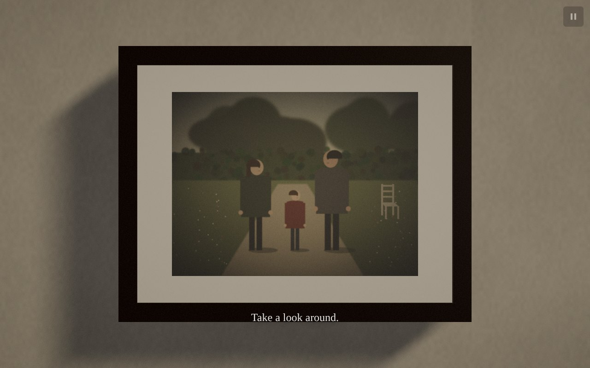
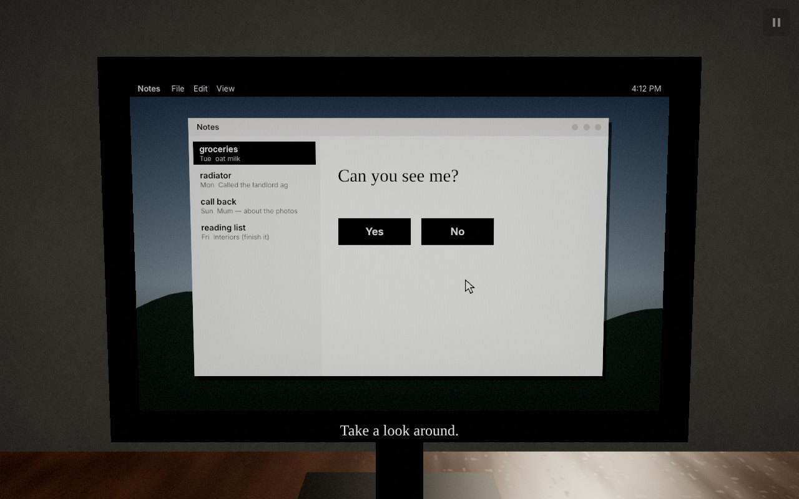
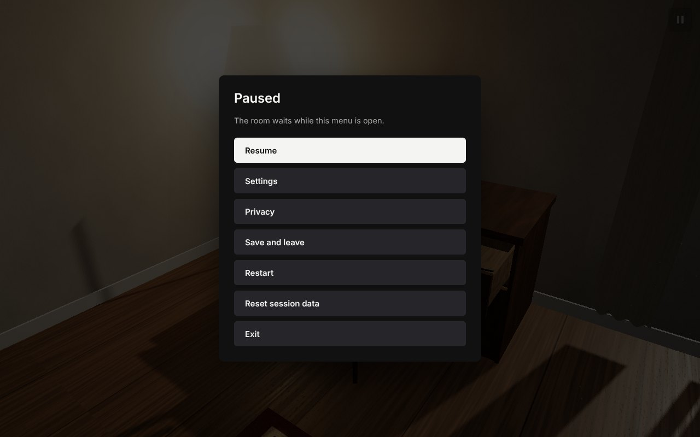

# The Website Is Watching You

An interactive psychological horror experience in a single, ordinary room. It is built with Three.js and WebGL2 and runs entirely in the browser.

You can open drawers, drag the chair, switch the lamp, take books off the shelf, look at the photograph and read the notes on the computer. For a while nothing is wrong. Then the photograph is slightly different, the chair is not quite where you left it, and the computer mentions something you did several minutes ago. The room keeps a model of what you look at, what you avoid, how long you hesitate and what you will probably do next. It uses that model to decide what to change, when, and where you will not be looking.


| | |
|---|---|
|  |  |
|  |  |
|  |  |

## Run it

```bash
npm install
npm run dev        # http://localhost:5173
npm run test       # unit and integration tests (Vitest, headless)
npm run build      # type-check and production build into dist/
npm run preview    # serve dist/ on http://localhost:4173
npm run test:e2e   # Playwright scenarios (see "End-to-end tests")
```

Requires Node 20+ and a browser with WebGL2. Audio starts when you press **Enter**; headphones help.

## Controls

| | Desktop | Touch |
|---|---|---|
| Look around | drag on empty space, or arrow keys | swipe on empty space |
| Use or inspect | click | tap |
| Move the chair | drag it | drag it |
| Hold an object | click a book, the cup or the figurine; drag to turn it; click a shelf slot to place it | tap, drag, tap |
| Zoom | mouse wheel | pinch |
| Leave inspection | click elsewhere or Escape | tap elsewhere |
| Pause, settings, privacy, exit | Escape or the pause button (top right) | pause button |

Keyboard players can use the centre of the view as the pointer: arrow keys to look, Enter or Space to use what is in the middle of the screen.

## Player safety and privacy

* The room records only what happens inside the 3D scene: clicks, inspections, camera direction and the pointer over the canvas. There is no event type for anything else (`src/telemetry/types.ts`).
* No webcam, microphone, location, fingerprinting, cookies, analytics or network requests. The site never asks for a permission.
* The computer inside the room is fiction. Every message is generated from authored templates and validated against the session's recorded events before it is shown. A validator rejects any line that claims access to the player's real device, files, identity or feelings (`src/narrative/validator.ts`).
* The pause menu is always available. It has Resume, Settings (volume, mute, reduced motion, sudden events on/off, quality, optional local model), Privacy, Save and leave, Restart, Reset session data and Exit. The privacy explanation is also reachable from the entry screen, before anything starts.
* Session data stays in memory. It is written to `localStorage` only when you choose **Save and leave**, and **Reset session data** removes it along with settings.
* A hidden tab or the open menu pauses session time, so nothing progresses in the background.
* An optional local language model (Ollama-compatible, off by default) can vary the wording of messages. Only `localhost` endpoints are accepted, it receives only a short list of in-room facts, and its output goes through the same validation, with the authored line as the fallback.

## How it works

The project is split into a pure simulation core (`src/game/GameCore.ts` and everything it composes) and a browser shell that renders the room and reports what the player sees and does.

```
pointer, camera ─► Interaction ─► Telemetry ─► Observer ─► Horror Director ─► Executor ─► WorldState ─► ScenePresenter
                   Attention estimator (frustum, occlusion, mirror, screen size, pointer) ──┘ visibility contracts │
                                                     Narrative (validated templates, delayed callbacks) ◄──────┘
```

* **Attention** is sampled 10 times a second. For each object it combines a frustum test, five occlusion raycasts, reflection through the mirror, screen size, distance from the view centre and pointer distance into a score. The result is one of four classes: attended, peripheral, occluded or offscreen.
* **Telemetry** stores typed, timestamped events with camera pose and room context. It also derives hesitation, avoidance, sound reactions, witnessed and investigated anomalies, and deliberate look-away tests.
* **The Observer** keeps continuous scores (familiarity, suspicion, curiosity, avoidance, predictability, tension, exposure, fatigue, testing), per-object interest, a behavioral profile, and a next-interaction predictor that learns online and is sometimes wrong.
* **The Horror Director** is an XState phase machine (Normalcy, Inconsistency, Recognition, Anticipation, Confrontation, Resolution) plus a catalogue of 49 anomalies. Each anomaly declares its phases, behavioral requirements, room prerequisites, visibility contract, cooldown, repetition limit and tension. Transitions depend on what the player did, not elapsed time alone. The Director deliberately does nothing at many opportunities.
* **Mutations** go through an executor that claims objects, checks the visibility contract every frame, and freezes in place without snapping if it is seen mid-change. Every change is stored with its cause and supporting evidence.
* **Three endings**: Acknowledgment, Refusal and Reversal. Each is reached through a gateway opened by the player's own behavioral profile.

Details:

* [docs/ARCHITECTURE.md](docs/ARCHITECTURE.md): systems, contracts, cadence, rendering, audio, determinism.
* [docs/BEHAVIOR.md](docs/BEHAVIOR.md): attention scoring, Observer model, prediction, phase requirements, pacing, the full anomaly catalogue, narrative validation, follower, endings.
* [docs/SCHEMA.md](docs/SCHEMA.md): behavioral event, object state, mutation record, anomaly and save formats.
* [docs/CASE_STUDY.md](docs/CASE_STUDY.md): *Building a Website That Watches You with Three.js, Behavioral Telemetry, and Procedural Horror*.

Everything is generated at startup, with no downloaded assets: geometry, wood and plaster textures, book spines, the clock face, the garden photographs, and every sound (25 one-shots and 4 ambient loops, synthesized in `src/audio/synth.ts`).

## Test mode and debugging

| URL parameter | Effect |
|---|---|
| `?seed=<n or text>` | fixes the random seed; the same seed and inputs replay the same session |
| `?test` | deterministic test mode: seed defaults to 1, `window.__wiwy` test hooks are installed, the drawing buffer is preserved for screenshots |
| `?speed=<0.1–50>` | scales session time (useful for watching pacing play out) |
| `?inspector` | opens the developer inspector at startup (dev server only) |

The **developer inspector** is only included in `npm run dev` builds and is loaded on demand; production builds do not contain it. Press the backquote key (`` ` ``) to toggle it. It shows:

* Observer state, ending affinity, prediction and profile.
* Progress toward the next phase.
* Every anomaly in the current phase with its eligibility reason or weight.
* Running events and recent Director decisions.
* The behavioral event log, including which systems used each event.
* Live attention estimates.

The test hooks (`src/app/testHooks.ts`) drive the real code paths. `simulate(ms)` advances the simulation in fixed 100 ms steps. `click(id)` goes through the interaction system. `forceGated(id)` asks the Director to run an anomaly through every gate. `openGateways([...])` stands in for the behavioral history that opens an ending, and the ending itself still has to be taken by the player through the phase machine's guard.

## Tests

* **Unit and integration** (`tests/unit`, 134 tests): telemetry, world state and collisions, attention with real three.js geometry, the Observer and predictor, narrative validation, every phase-transition guard, Director gates and cooldowns, freeze-on-sight interruption, claims and preemption, the follower, the entity, and full `GameCore` sessions. Those sessions include a passive player who stays in Normalcy for 20 minutes, a run that reaches Confrontation through real metrics only, each ending through its gateway, and seed replay.
* **End-to-end** (`e2e/`, Playwright): starting and exploring, inspecting the photograph, a valid offscreen mutation and discovering it, the drawer, a delayed accurate callback, pointer trails and the follower, an anticipated interaction, phase progression, all three endings, pause/save/restart/reset, and a phone viewport. Each scenario captures screenshots into `e2e-screenshots/`.

The Playwright config builds the app, serves the production build, and runs Chromium with SwiftShader so it works on machines without a GPU. Set `PLAYWRIGHT_CHROMIUM` to point at a specific Chromium binary; otherwise the config uses `/opt/pw-browsers/chromium` locally and Playwright's managed browser in CI.

## Performance notes

* Narrative decisions run every 500 ms and attention and prediction at 10 Hz, never per frame.
* All textures, sounds, capture render targets (six 640×480 half-float targets plus a surveillance feed) and the 720-instance trail mesh are created up front.
* One shadow-casting light.
* An adaptive pixel ratio holds a 60 fps budget on desktop and 30 fps on coarse-pointer devices. The **Low** quality setting disables depth of field and reduces particles.
* Frame rates have not yet been measured on real GPU hardware. The automated runs use software rendering, which is much slower than any GPU and says nothing about real-world frame rate.

## Project layout

```
src/app          shell, session lifecycle, effects, test hooks
src/attention    attention estimator
src/audio        procedural synthesis and the audio director
src/core         seeded RNG, session clock, layout constants, math
src/debug        dev-only inspector
src/director     phase machine, anomalies, Director, Executor
src/endings      the three endings
src/entity       hidden presence on a nav graph
src/game         GameCore
src/interaction  camera rig and pointer/touch/keyboard interaction
src/narrative    templates, validator, callbacks, local LLM adapter
src/observer     Observer model and predictor
src/persistence  local-only save and settings
src/scene        room, textures, photographs, presenter, captures, computer, trail, post-processing
src/telemetry    behavioral events
src/trail        pointer history and follower
src/ui           DOM overlay
```
