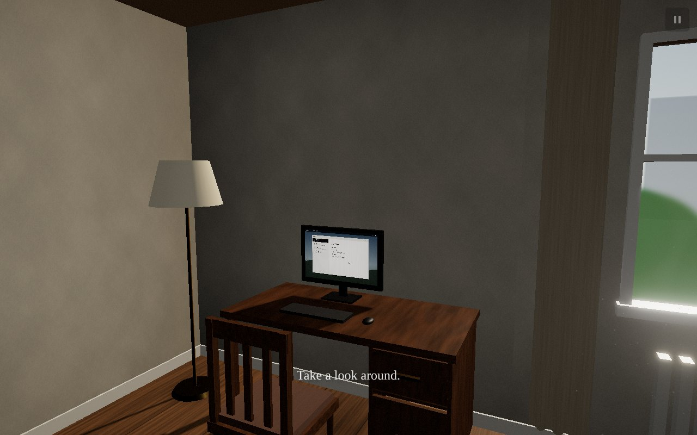
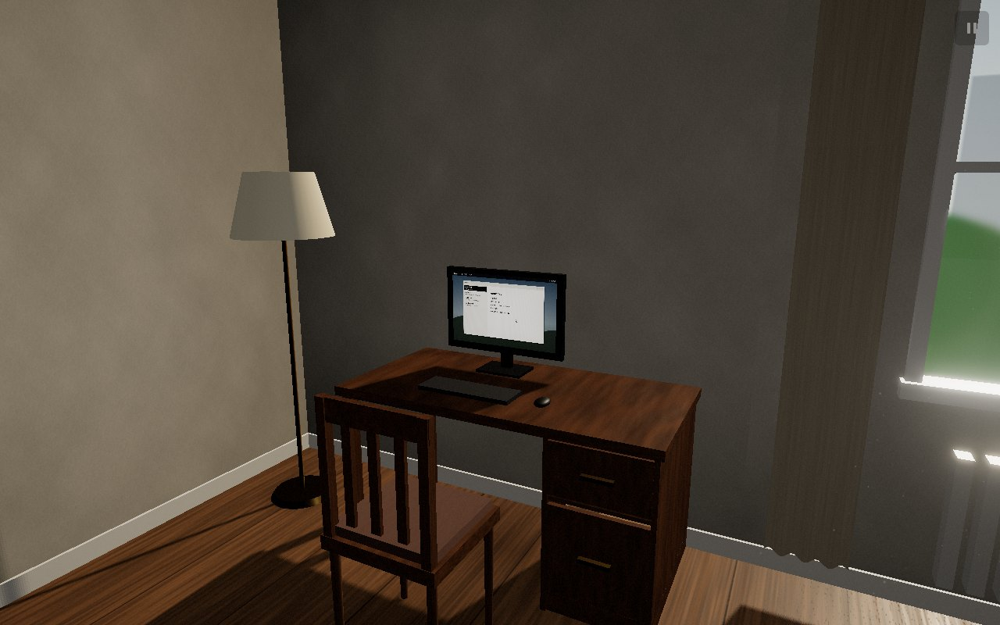
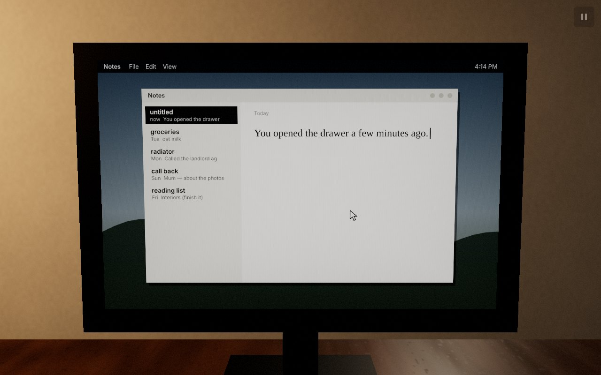
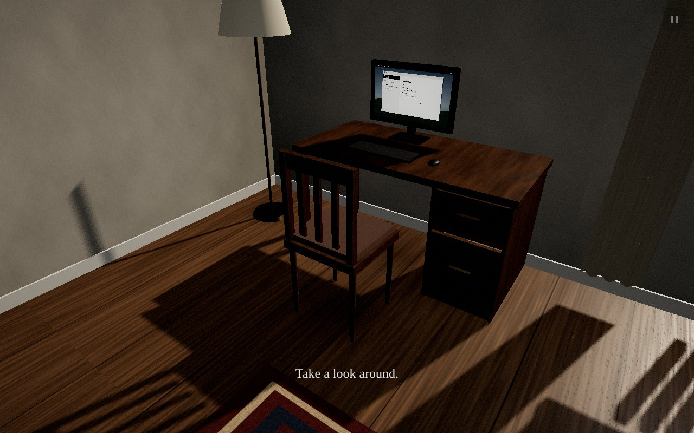

# Building a Website That Watches You with Three.js, Behavioral Telemetry, and Procedural Horror

*A technical write-up of an experiment: an ordinary 3D room that slowly makes it clear that it has been paying attention.*



## Introduction

Most horror on the web reaches for the obvious props: a dark corridor, a face in the static, a sudden noise. I wanted to try the opposite. Make a room so ordinary that the first few minutes are just pleasant fiddling. Drawers slide on springs, the lamp warms up, the chair has weight when you drag it. Then let the room change in ways that could plausibly be your own mistake.

The idea behind the project is that the room should feel like it is studying you. That only works if the room actually *is* studying you, in a narrow and honest sense. It records what you do inside the scene, keeps a model of what you look at and what you avoid, tries to predict your next click, and uses all of that to choose what to change and when. Every personal statement it makes has to be true. If the computer says "Did you expect something different the second time?", you really did open that drawer twice.

I chose a modest home office rather than a haunted house for a practical reason: uncertainty needs a baseline. You can only doubt your memory of where the chair was if the chair is the kind of object you would never think about. A realistic room gives the player expectations for free, and every anomaly in the project is a small violation of one of them.

The finished experiment is about 11,700 lines of TypeScript in `src/` and 2,300 lines of tests. There are 49 anomaly definitions, 20 authored message templates, 25 behavioral event types, 18 mutable objects and three endings. It has no downloaded assets.

## Making the room feel real

### Geometry and materials without a single asset file

The brief suggested modelled assets loaded with `GLTFLoader`. No assets were supplied, so I built everything procedurally in `src/scene/RoomBuilder.ts`. Furniture is assembled from boxes, cylinders and lathe shapes with real-world dimensions: a 0.75 m desk, 0.45 m seat height, a 2.7 m ceiling, books 0.17 m deep. Surface detail comes from textures painted into canvases at startup: wood grain with per-plank variation, slightly uneven plaster, woven fabric, individual book spines with titles, a clock face, a handwritten note and the garden photographs.

The tradeoff is real. A good artist would make a more convincing room than a generator. But the procedural approach gave me two things I came to value. First, nothing loads during play. The brief was explicit that a photograph swap must not stall on a texture fetch, and here every variant already exists in GPU memory before the player clicks **Enter**. Second, the photographs could be composed from the same parts. The family photo is painted by `photoPainter.ts` as a scene graph of people on a lawn, so "one person has moved", "one person is gone" and "one person is looking at you" are different compositions of the same painting with the same film grade, not separately drawn images that might not match.

Materials are plain `MeshStandardMaterial` and `MeshPhysicalMaterial`: clearcoat on the desk and mirror frame, and a nearly transparent clearcoated layer over the photograph so it catches the window. Ambient occlusion is baked into the wall texture, and soft contact shadows under furniture are baked into floor decals. Only one light casts real-time shadows: the sun through the window, with a 2048² shadow map.

### Interactions that are worth doing for their own sake

The first five minutes have to be satisfying without any horror, so the interaction layer got as much attention as the director. A few details that mattered:

* **Springs, not tweens.** Drawers, the door, its handle and the curtains are driven by a damped spring toward the world state (`springStep(pos, vel, target, k, c, dt)`). The world state is authoritative and the presenter only adds physical motion. Because of this, the anomaly engine can change a drawer's `open` value and the drawer moves like a drawer instead of teleporting.
* **A chair with mass.** Dragging the chair moves a target point on the floor. The chair follows with velocity and damping, swivels slightly with lateral motion, and is resolved against the furniture's floor footprints every frame. Hitting the desk kills most of its velocity.
* **Drag disambiguation.** On pointer-down the system records what is under the pointer. It only decides after 6 px of movement: the chair drags the chair, a held book rotates the book, anything else turns the camera. A press longer than 700 ms is never a click. This works the same for touch, with pinch handled separately.
* **Interruptible inspection.** Clicking the photograph flies the camera to an inspection pose. Every transition starts from wherever the camera is *now*, so clicking something else halfway is smooth. Returning restores the yaw and pitch you left with.

## Detecting what the player is looking at

Everything in the project depends on one question: *is the player looking at this object right now?* If the answer is wrong, a photograph changes while you watch and the illusion is gone. The `AttentionEstimator` answers it ten times per second of play.

For each tracked object it tests five points over the object's bounding sphere (the centre, plus offsets along the camera's right and up vectors) against the view frustum. It then raycasts from the camera to each point that is inside, against the room's occluders. A single centre-point test fails on partially hidden objects, like the chair behind the desk. Five samples give a `visibleFraction` that degrades gracefully. The object's own meshes are excluded from its occlusion test; otherwise every object occludes itself.

The mirror needed its own path. The room has a real planar reflection, so an object behind you can be visible. The estimator reflects the object's centre across the mirror plane, checks whether the line of sight passes through the glass rectangle, and marks the object as seen. An object seen in the mirror is not *attended*, but it is not unseen either, and that is what matters for the mutation engine.

The score itself is deliberately simple:

```ts
const centrality = 1 - smoothstep(0.05, halfFov * 1.25, e.centerAngle);
const size = smoothstep(0.02, 0.35, e.screenSize);
const pointerAtt = Number.isFinite(e.pointerDistance) ? 1 - smoothstep(0.02, 0.25, e.pointerDistance) : 0;
e.score = clamp01(e.visibleFraction * (0.6 * centrality + 0.2 * size + 0.35 * pointerAtt));
e.visibility = e.score >= ATTENDED_THRESHOLD ? 'attended' : 'peripheral';
```

The pointer term is a hint, not eye tracking. People often look at something while the pointer sits elsewhere. But when the pointer rests on an object off to the side, the player is probably aware of it, so it can lift a peripheral object over the 0.42 threshold. The weights don't sum to one on purpose: a centred, large object with the pointer on it saturates, and a centred object without the pointer still clears the threshold.

Four classes come out of this: **attended**, **peripheral**, **occluded** and **offscreen**. The estimator also tracks `unseenForMs`, which is what most anomalies actually ask about.

## Changing objects when nobody is looking

### Valid states, not arbitrary edits

Every mutable object has an explicit list of valid states and numeric ranges (`src/world/objects.ts`). The photograph can be `original`, `shifted`, `removed`, `gazing`, `room_now`, `room_past`, `room_figure` or `empty`. The chair can be `original`, `rotated_slight`, `crept`, `closer_desk`, `facing_wall`, `facing_player_prev`, `facing_player_now` or `player_moved`. `WorldState.apply` rejects anything else. It also rejects chair positions that collide with furniture and books placed in occupied slots. Every committed change becomes a `MutationRecord` with `from`, `to`, `source`, `cause` and the telemetry event ids that justified it. That history is what lets the room reverse a change, intensify it later, or refer back to it.

The collision check was where the tests paid off. A randomized test that throws thousands of random targets at `resolvePosition` (4,000 in the suite, 20,000 in a one-off check) found that about 16 % came back still colliding. In pockets narrower than the chair, pushing out of one obstacle and clamping to a wall cancel each other out. The fix keeps the push-out and adds a ring search for the nearest free point when the result still collides. Without it, `chair_return_desk` was silently failing about one time in six.

### Visibility contracts

Every anomaly declares a contract:

```ts
interface VisibilityContract {
  mode: 'unseen' | 'peripheral' | 'direct';
  minUnseenMs: number;
  interruption: 'freeze' | 'revert' | 'continue';
  waitMs: number;
}
```

The first photograph change is `unseen(8000, 'freeze', 60_000)`. The photograph must have been out of sight, including in the mirror, for eight seconds. The event may wait up to a minute for that to happen and then gives up. The executor checks the contract before every step and on every frame of an animation. The interesting case is getting caught halfway through:

```ts
if (!Executor.permitted(contract, obj, ctx, false)) {
  if (contract.interruption === 'continue') {
    // allowed to keep moving in view
  } else if (contract.interruption === 'revert' && !r.changed) {
    this.finish(r, 'interrupted', 'seen before any change', ctx);
    return false;
  } else {
    // freeze: stop exactly where it is, commit the partial change, no snap.
    this.commitPartial(r, obj, ctx);
    this.finish(r, 'interrupted', 'seen while moving; froze in place', ctx);
    return false;
  }
}
```

When the chair is creeping toward the desk and you turn around, it stops exactly where it is. It does not snap back to where it was, which would be a visible teleport, and it does not finish the move, which would be visible motion. The partial change is committed with a `:partial` cause, so the room's memory matches what you saw. A unit test turns the camera onto the chair mid-animation and checks frame by frame that the position never changes again.

Two other rules prevent contradictions. An anomaly must **claim** all its target objects before starting, and a second anomaly cannot claim an object that is already claimed. The **player always preempts**: picking up a book that an anomaly has claimed cancels that anomaly cleanly.



## Building the Observer

### Behavioral events

Telemetry records typed events with a session-relative timestamp (active play only), the camera pose, room context, an optional duration and metadata. The type list is closed: there is no event for anything outside the room. On top of the deliberate actions, `GameCore` derives signals from the attention stream. Hesitation is the pointer resting on an object for 300 ms or more before clicking, or 900 ms or more before leaving. Others are glancing at an area, avoiding an area, turning toward a sound or failing to, witnessing a changed object (attended for 600 ms), investigating it (touching it within 30 s), reading a message, and the one I like best, `look_away_test`.

A look-away test fires when the player watches an object for at least 700 ms, looks away for 1.2 to 8 seconds, and looks back, twice within 45 seconds. That is the behavior of someone checking whether the room changes things when they are not looking. The brief called this "the defining moment": the player starts deliberately testing the room, and the room notices. The Observer's `testing` score rises. The Director *protects* the tested object, so it is the one thing that never changes. Later a template can say "You keep looking away to see if I move it." only if that event exists.

### Scores, not categories

The Observer keeps continuous values (familiarity, suspicion, curiosity, avoidance, predictability, tension, exposure, fatigue, testing), plus per-object interest that decays with a five-minute half-life. None of them rise with time alone. Avoidance was the hardest to get honest. It is exactly zero until the player has 150 seconds of active play and 90 seconds of attention samples. Even then it needs a share of attention far below an even split, plus declined opportunities: abandoned hesitations at that area's objects, or sounds from that area the player did not turn toward. A player who simply hasn't got round to the hallway yet is not avoiding it.

### Prediction

The predictor is a softmax over the on-screen interactables plus a fixed "no interaction" logit. Its features are pointer direction, pointer proximity, view centrality, recent dwell, the Markov transition probability from the last thing the player touched, and historical frequency. When the top candidate passes 0.5 (plus a per-target bias), it **commits** to a prediction. A commit lives 4.5 seconds and then resolves as a hit, a miss or expired against what the player actually does.

Two small mechanisms make it feel like an imperfect intelligence instead of a script. Each real interaction takes one cross-entropy gradient step on the feature weights, so the model starts out bad and gets better at *you*. A miss raises that target's threshold by 0.06, so the Observer becomes more cautious about predicting the thing it got wrong. Both outcomes are recorded as events, so the narrative can use a correct prediction ("I thought you'd check the door.") only after it was correct.

## Making the room remember

The narrative system has one rule: **no statement without evidence**. Each template has an evidence function that returns the event ids the statement depends on, or null if it would be false:

```ts
{
  id: 'drawer_second_time',
  intent: 'observation',
  phases: LATE,
  text: 'Did you expect something different the second time?',
  once: true,
  priority: 3,
  evidence: ({ telemetry }) => {
    const e = telemetry.query({ type: 'drawer_opened' });
    return e.length >= 2 ? { refs: ids(e.slice(0, 2)), facts: { count: e.length } } : null;
  },
},
```

After a template fills in its facts, `validateStatement` checks the text again. Every referenced event must exist. A list of forbidden claims catches any wording that drifts toward the player's real computer, files, browser, location, identity or feelings. In strict mode, used for model-generated variations, every object word and every number must match the evidence. The test suite runs every template against an empty session in every phase (all must refuse) and against 25 random seeded sessions (every reference must exist).

**Delayed callbacks** are where the room starts to feel uncanny. When an ordinary action happens, the narrative system remembers it with probability 0.45, keeping at most six pending and only one per action type. The callback becomes deliverable 140 to 320 seconds later. When the Director picks the `callback_message` anomaly, the oldest due callback is phrased ("A few minutes ago you closed the curtains.") and validated again. If the fact is no longer true, it is dropped silently. The selectivity matters more than I expected. A room that comments on everything is a chatbot. A room that brings up one minor thing from five minutes ago is unsettling.



There is an optional local language model adapter for variety. It only talks to `localhost`, receives the intent, the authored line and a short list of allowed facts with their event ids, and may only return wording plus citations. Anything unparseable, slow (over 2.5 s), or failing strict validation falls back to the authored line. The model has no API for touching state, and that is the whole safety argument: it cannot do anything except propose a sentence.

## Creating the cursor follower

From the anticipation phase on, the pointer starts leaving faint marks on the surfaces it passes over. A second set of marks then appears along the same path, a few seconds late.

The pointer is raycast into the room at about 30 Hz, and the hit point, the surface normal and a **surface id** (the floor, the desk top, a specific wall, a specific object) are pushed into a bounded history: 900 points, at least 3.5 cm apart. The surface id matters. Marks never bridge two surfaces, so the follower doesn't draw a line through the air between the desk and the wall.

The marks are a single `InstancedMesh` of 720 small quads oriented to the surface normal and offset slightly along it. Opacity fades in the shader by age (5 s for the player, 7.5 s for the follower). There are no draw calls per mark and no allocations during play.

The follower is a simulation (`FollowerSim`) with four stages. At stage 2 it replays the path 6.5 s behind. At stage 3 the delay starts at 2.6 s and shrinks with each interaction, down to 1.1 s, and the follower stops when the player stops. At stage 4 it occasionally takes a shortcut: either toward the point on the same surface the predictor thinks you are heading for, or across a loop you just drew.

That last part had a bug that the tests found. The loop search only scanned path points that were already due to be replayed. `GameCore` updates the follower every frame, so that window was one or two points and loop shortcuts never happened at frame rate. The fix lets the search look ahead to any recorded point at least half a second old, and a unit test now draws quick circles at 60 Hz and requires a shortcut to happen.



## Designing the Horror Director

### Phases as a state machine

The director's narrative structure is an XState v5 machine with six phases. Transitions are evaluated every 500 ms with live metrics and guarded by explicit requirements:

| Transition | Requirements |
|---|---|
| Normalcy → Inconsistency | 75 s in phase, 6 interactions, 4 distinct objects |
| Inconsistency → Recognition | 120 s, 3 anomalies applied, 14 interactions, and 1 witnessed or 22 interactions |
| Recognition → Anticipation | 150 s, 2 messages, 1 delayed callback, 18 predicted interactions |
| Anticipation → Confrontation | 150 s, 2 anticipations, follower stage 2, tension 0.2 |
| Confrontation → Resolution | 2 confrontation events, an open gateway, the player taking it |

Time in phase is never sufficient on its own. An integration test leaves a passive player in the room for twenty simulated minutes and asserts that nothing changes. The unit tests check each guard with every metric exactly at its requirement, then with each metric just under, to confirm that extra time doesn't compensate.

### Eligibility and pacing

Every anomaly passes the same gates, in order: phase, repetition limit, cooldown, spacing from related groups, the "sudden events" setting, not already running, behavioral requirement, room prerequisite, tension budget, a valid plan (a collision-free target must exist), and finally that the targets are not being tested, busy or claimed. The first gate that fails is recorded as the reason, which makes the developer inspector useful. You can see that `chair_creep` is waiting on "tension budget" and `photo_gazing` on "behavioral requirement unmet".

Eligible candidates are picked by weighted random choice: `baseWeight × affinity × novelty × fatigue`. Affinity is where the Observer shapes the room. Photo anomalies scale with interest in the photograph. Footsteps in the hallway become more likely the more the hallway is avoided, and fall away when the player keeps investigating the door. Offscreen scrapes, the passing shadow and the follower's appearance scale with avoidance. The chair's creep scales with how still the player tends to be. Novelty is `1 / (1 + 0.8 × exposure)`.

The most important pacing parameter turned out to be **restraint**. At each attempt, every 5 to 11 seconds, the Director chooses to do nothing with probability 45 % in Inconsistency, falling to 20 % in Confrontation, even when something is eligible. After an event there is a quiet period that depends on its significance, from 8 to 15 seconds for ambient events up to 70 to 110 seconds for major ones. A tension cap per phase stops escalation from running ahead of the story. Without restraint, a room that responds to everything becomes predictable within minutes.

All randomness flows through one seeded mulberry32 generator, so a seed reproduces a session. This was essential for the tests, and it also made it practical to debug a strange event: the seed and the inputs reproduce it.

## Making the room anticipate actions

Anticipation anomalies are evaluated on prediction updates instead of the main tick, and they pass the same gates as everything else. They require an active prediction commit on their target:

```ts
requires: (ctx) => (ctx.commit?.target === 'door' && !ctx.commit.response ? [] : null),
```

When the pointer drifts toward the door and the predictor commits, the handle turns a little (0.35 of its travel, over 700 ms). It holds while the pointer stays, stops when the player pauses, and returns over 1.8 seconds once the prediction moves elsewhere. The lamp version only exists for players who habitually turn the lamp on, and turns it on as the pointer approaches. The photograph version tilts the frame a few degrees toward the camera as you turn toward it.

Failed predictions are part of the design. When the room turns the handle and you go to the bookcase instead, that is recorded as a miss. The threshold for the door goes up, and the room is a little less eager next time. The intent is that these misses make the hits read as attention rather than as a trigger volume.

## Audio and silence

Every sound is synthesized at startup in `src/audio/synth.ts`, about 290 lines of small DSP building blocks (biquad filters, swept band-passes, noise, envelopes, a stick-slip model for the chair scrape, and a short room reverb). That produces 25 one-shots and four seamless ambient loops: room tone, distant traffic, the fan and electrical hum. The audio director creates `AudioBuffer`s only on the first user gesture, which keeps autoplay policies happy. It plays one-shots through a pool of 14 `PositionalAudio` voices placed where the sound happens.

The ambience has its own mix per phase. Traffic recedes as the story progresses and room tone grows slightly. The most effective audio event, though, is the removal of sound. `silence(ms, level)` drops the ambient layers quickly, holds them, and lets them return slowly. The `unnatural_silence` anomaly fires when the player stops moving. The clock ticks are driven by the second hand on the visible clock, so when the clock stalls the ticking stops with it, and the `clock_skip_tick` anomaly drops a tick or two. There is no music anywhere, and no sound is louder than a door closing.

## Optimization

* **Evaluation frequency.** The render loop does almost no narrative work. Phase evaluation and scheduling run every 500 ms, attention and prediction at 10 Hz, and Observer decay at 2 Hz. Per frame, the executor only checks the contracts of running events (at most two or three).
* **Allocation discipline.** All capture targets are preallocated: six 640×480 half-float targets in an LRU with pinning for the photo currently shown, plus one surveillance feed target. The trail is one instanced mesh, and textures are painted once. `CaptureService` renders the fictional room from a fixed corner camera with the photo frame hidden, so a "photograph of the room" never contains itself.
* **Lights and shadows.** There is one shadow-casting light. The lamp is a point light without shadows. The window's soft fill is a `RectAreaLight`.
* **Post-processing.** Depth of field only runs while inspecting an object, and only on the high quality setting. Bloom is low-strength, and the grade is a single pass.
* **Adaptive resolution.** A 90-frame average adjusts the pixel ratio in 0.15 steps against a 16.9 ms budget on desktop or 33.4 ms on coarse-pointer devices.

On numbers: the automated end-to-end tests run Chromium with SwiftShader, a software rasterizer, so the frame rates they report reflect the CPU running the tests, not the experience. I have not measured the experience on GPU hardware yet, and I'm not going to quote a frame rate I haven't measured. The production bundle is about 1.1 MB of JavaScript (about 335 KB gzipped). Three.js is 835 KB of that and ships as its own chunk; the game itself is 266 KB (85 KB gzipped).

## Testing a horror game

Testing a game about uncertainty sounds contradictory, but the architecture made it straightforward. `GameCore` has no rendering dependencies. The browser provides a `VisibilityOracle`, and the tests provide a scripted one, so the same director, executor, observer and narrative code runs headlessly in Vitest. There are 134 tests that run in about two seconds, including full sessions: a run that reaches Confrontation by satisfying every guard with real metrics, each ending through its gateway, and seed replay producing identical sessions.

The Playwright suite runs in a real browser against the production build. Twelve scenarios cover exploring, inspecting the photograph, a valid offscreen mutation and discovering it, the drawer, a delayed accurate callback, pointer trails, an anticipated interaction, phase progression, all three endings, pause/save/restart/reset, and a phone viewport. A `?test` mode exposes hooks that drive the real paths. `simulate(ms)` advances the simulation in fixed steps so a five-minute callback delay takes a second. `forceGated(id)` asks the Director to run an anomaly through every gate instead of bypassing them. The ending tests open a gateway as a stand-in for a long behavioral history, but the player still has to take it, and the phase machine still checks its guard.

## Closing thoughts

**What the design rests on.** Not any single anomaly, but three rules working together: the freeze-on-sight rule, so the room is never caught cheating; restraint, so you can't tell whether something is about to happen; and evidence-backed messages, so that when the room talks about you, it is right. The moment the whole system is built toward is a delayed callback about something trivial, minutes after the player has forgotten doing it. This write-up covers the engineering; it does not report results from player testing, which hasn't happened yet.

**What was hard.** Attention estimation has many edge cases: partially occluded objects, the mirror, objects you are holding, and the photograph when you are standing next to it. The avoidance score needed hard evidence thresholds, because a model that accuses you of avoiding the hallway when you simply haven't got to it yet would feel broken rather than creepy. The collision and follower bugs the tests found were both cases where things worked in a demo and failed statistically.

**What I'd improve.**

* A modeled room with baked lightmaps would look considerably better than procedural geometry with real-time lighting, and the architecture already treats the room as a swappable shell.
* The predictor's features are hand-picked; a small learned model trained on recorded sessions (with consent) would be an interesting next step.
* I would like real performance numbers from a range of GPUs before calling the frame-rate targets met.
* The Reversal ending's replay currently covers toggles and sounds. Replaying held-object movement along its original path would make it stronger.

The room never needed a monster. It only needed to remember what you did, decide carefully when to show you, and never be caught deciding.
